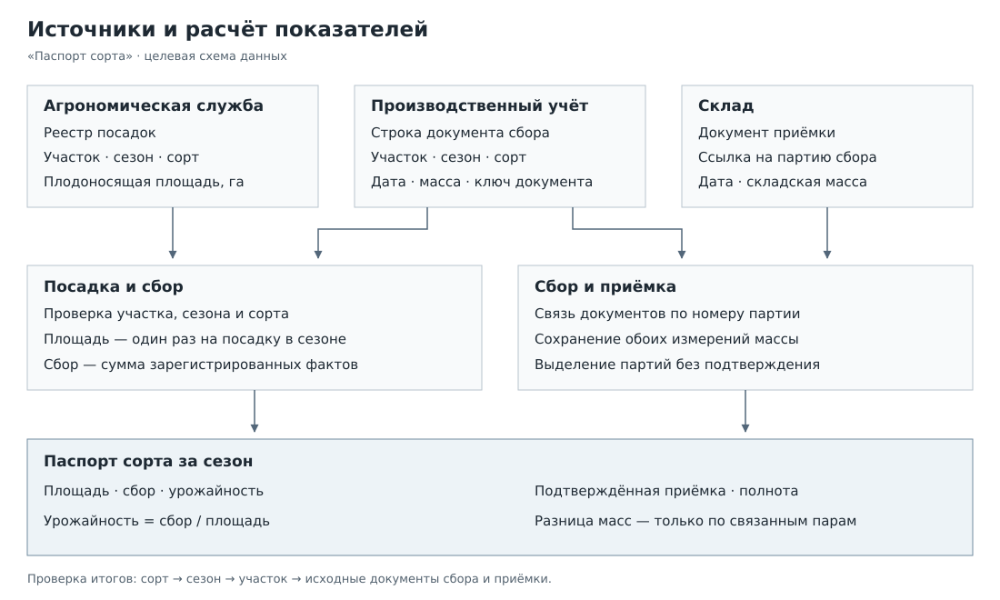

<a id="top"></a>

# «Паспорт сорта»: требования к производственной отчётности

**Рабочий кейс · системный аналитик в команде цифровизации**  
**Период:** весна 2026 года, около квартала.

[Задача](#business) · [Обязанности и взаимодействие](#team) · [Ход работы](#my-work) · [Результат](#result) · [Документы](#artifacts) · [← Портфолио](../README.md)

<a id="business"></a>

## Задача

Предприятие выращивает яблоки. Руководителю производства и агроному нужен «Паспорт сорта» — отчёт, по которому можно сравнить сбор и урожайность сортов за сезон, увидеть складское подтверждение и проверить итог по участкам и исходным документам.

Для расчёта требовалось объединить сведения трёх подразделений: реестр посадок агрономической службы, документы сбора производства и документы приёмки склада. У каждого источника свои записи и коды. Одного совпадения названия сорта или даты документа недостаточно для связи.

**Моя задача — определить состав данных, правила их сопоставления и расчёта показателей, описать процесс и требования к обмену.** Регистрация партии и складская приёмка входят в этот объём как источники сведений для отчёта.

В учёте существенны три особенности:

- С одного участка собирают несколько раз за сезон; его плодоносящая площадь должна попасть в знаменатель урожайности один раз.
- Производство и склад фиксируют собственные измерения массы. Расхождение требует сверки документов и сохраняется в отчёте.
- Отсутствие складского подтверждения означает неполноту сведений. По нему нельзя сделать вывод о недостаче.



Материалы адаптированы для открытой публикации. Контракты, SQL и контрольные данные воспроизводят правила задачи в публичной технической модели.

<a id="team"></a>

## Обязанности и взаимодействие

Я занималась обследованием процесса, описанием справочных данных и подготовкой требований. Работа включала интервью с участниками, наблюдение за операциями учёта, разбор документов и уточнение исключений. Сезонные операции сбора разбирались по документам и объяснениям сотрудников.

| С кем работала | Предмет обсуждения | Моя ответственность |
|:---|:---|:---|
| Агрономическая служба | Связь сорта с участком и сезоном, плодоносящая площадь, спорные наименования | Описать состав справочных данных и вопросы, требующие подтверждения агронома |
| Производственный учёт и склад | Оформление сбора и приёмки, поиск связанных документов, повторы и исправления | Восстановить последовательность действий, выделить ключи записей и правила разбора расхождений |
| Руководитель производства и пользователи отчёта | Состав показателей, детализация до участка и документа, неполные сведения | Сформулировать требования к отчёту и условия проверки результата |
| Экономисты | Учётная номенклатура, первичные документы, границы количественного и стоимостного учёта | Уточнить связи источников и отделить расчёт урожайности от методики затрат |
| Разработка и аналитик отчётности | Обязательные поля, проверки, исключения и формулы | Подготовить спецификации и разбирать вопросы к требованиям |

При согласовании я фиксировала вопрос, его владельца и правило, которое нужно отразить в документации. За достоверность сорта и площади отвечала агрономическая служба, за исходные документы — производство и склад. Моя зона ответственности — полнота и согласованность требований.

[Вопросы к участникам, материалы для сверки и распределение решений](docs/stakeholders.md#elicitation).

<a id="my-work"></a>

## Ход работы

| Этап | Что делала | Что зафиксировано в документации |
|:---|:---|:---|
| Обследование | Разбирала, где возникают сведения о посадке, сборе и приёмке, кто их вводит и как исправляет | Исходный процесс, состав источников, владельцы данных |
| Анализ данных | Сопоставляла единицу записи и ключи источников; выделяла повторы, неоднозначные коды и несвязанные документы | Исходная модель, правила соответствия кодов, перечень ошибок данных |
| Требования | Описывала действия участников, обязательные проверки и поведение при исключениях | Пять вариантов использования, бизнес-правила, требования к обмену |
| Проверка решений | Разбирала расчёт площади, два измерения массы, повтор документа и неполную приёмку | Формулы показателей, контрольные примеры и критерии приёмки |

В [разборе решений](docs/processes.md#decisions) показано, как особенности учёта повлияли на требования. Например, соединение площади участка со строками каждого сбора повторяет одну площадь несколько раз. Поэтому площадь и сбор сначала рассчитываются отдельно по сорту и сезону, а затем объединяются.

<a id="result"></a>

## Результат работы

Подготовлены описание процесса и данных, требования к «Паспорту сорта» и обмену, сценарии исключений и критерии приёмки. В документации определены:

- основания расчёта: посадка задаёт площадь, документ сбора — производственную массу, документ приёмки — складскую;
- связи записей и действия при неоднозначности: неподтверждённое соответствие передаётся владельцу данных;
- поведение при повторах и исправлениях: повтор не создаёт новый факт, изменённая строка требует разбора;
- трактовка отчёта: расхождение связанных измерений отделено от отсутствующих подтверждений.

### Проверка расчёта

В репозитории есть исполняемый SQL-пример. Его данные условные; они подобраны для проверки правил учёта.

| Контрольная ситуация | Проверяемый результат |
|:---|:---|
| На участке 2 га два сбора: 8,420 и 1,580 т; на участке 3 га один сбор: 5 т | Сбор — 15 т; площадь — 5 га; урожайность — 3 т/га |
| Склад подтвердил только первый сбор: 8,370 т вместо 8,420 т | Разница связанной пары — −0,050 т |
| По двум другим сборам подтверждений нет | Без подтверждения — две партии общей производственной массой 6,580 т |

[Результат SQL-проверки и условия воспроизведения](docs/acceptance.md#verification). Это проверка публичной модели данных; испытания API и обмена описаны отдельно в плане приёмки.

<a id="artifacts"></a>

## Порядок чтения

| Порядок | Материал | Содержание |
|:---|:---|:---|
| 1 | [Процесс и разбор решений](docs/processes.md) | Исходный порядок учёта, спорные ситуации и основания требований |
| 2 | [Варианты использования](docs/use-cases.md) | Действия пользователей, реакция системы, альтернативы и ошибки |
| 3 | [Модель данных и показатели](docs/data-model.md) | Источники, связи, ограничения и расчёт отчёта |
| 4 | [План и результаты проверок](docs/acceptance.md) | Условия приёмки и воспроизводимая проверка SQL |

<a id="technical"></a>

<details>
<summary>Документы по отдельным вопросам и технические приложения</summary>

- **Предметная область:** [границы задачи](docs/context.md), [участники и согласование](docs/stakeholders.md).
- **Требования:** [каталог](docs/requirements.md), [соответствия сортов](docs/master-data.md), [подготовка исторических данных](docs/migration.md).
- **Обмен:** [описание](docs/integration.md), [OpenAPI](contracts/openapi.yaml), [схема сообщений](contracts/events.schema.json), [Postman](contracts/postman.collection.json).
- **Данные и модели:** [SQL](sql/), [контрольные данные](examples/), [UML и BPMN](diagrams/README.md).
- **Сопровождение документации:** [версии и проверки](docs/versioning.md).

</details>

<a id="checks"></a>

<details>
<summary>Проверка спецификаций и примеров</summary>

Из корня репозитория:

```bash
python -m pip install -r agritech/requirements-check.txt
python agritech/scripts/validate.py
python agritech/scripts/normalize.py
python agritech/scripts/check_legacy.py
```

Валидатор проверяет форматы, примеры, ссылки и наличие связей требований с приёмкой. Выполнение SQL проверяется [отдельно](docs/acceptance.md#verification).

</details>

[↑ К началу](#top)
