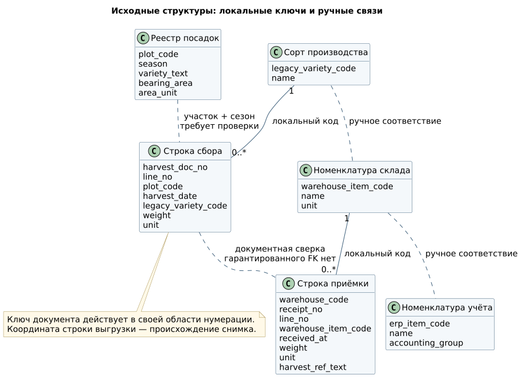

<a id="top"></a>

# Производственный учёт: от сбора урожая до складской приёмки

**Коммерческий контекст · системный анализ · справочные данные · «Паспорт сорта»**

[Моя работа](#my-work) · [Задача бизнеса](#business) · [Разбор решения](#solution) · [Документация](#artifacts) · [Проверки](#checks) · [← Портфолио](../README.md)

**Моя роль — системный аналитик в команде цифровизации производственного предприятия.** Моя зона — описание процессов и справочных данных, требования к взаимодействию внутренних систем и подготовка данных для отчёта «Паспорт сорта». Документация адаптирована для портфолио: названия, идентификаторы и примеры данных обезличены; техническое решение представлено в проектной модели.

<a id="my-work"></a>

## Что я делала

| Моя задача | Что подготовила | Где посмотреть |
|:---|:---|:---|
| Разобрала путь данных от сбора на участке до приёмки на складе | Описание исходного процесса, точки повторного ввода и ручной сверки; целевой порядок работы | [Процессы](docs/processes.md) |
| Описала участников и ответственность за данные | Разделение задач производства, агронома, склада и учёта; перечень решений для согласования | [Участники](docs/stakeholders.md) |
| Систематизировала справочники и исходные записи | Сорта, участки, посадки, документы сбора и приёмки; локальные ключи и правила сопоставления | [Справочники](docs/master-data.md) · [Исходная модель](docs/data-model.md#source-data) |
| Формализовала требования | Бизнес-правила и пять сценариев: согласование сорта, регистрация сбора, приёмка, отчёт и разбор расхождений | [Сценарии](docs/use-cases.md) · [Требования](docs/requirements.md) |
| Проработала передачу данных между производством и складом | Состав запросов и сообщений, связь документов, ответы на ошибки и правила повторной обработки | [Спецификация обмена](docs/integration.md) |
| Описала данные для «Паспорта сорта» | Состав показателей, источники, формулы и правила учёта неполных данных | [Показатели отчёта](docs/data-model.md#variety-passport) · [SQL](sql/02_passport.sql) |
| Подготовила критерии приёмки и контрольные примеры | Проверки правил, дублей, расхождений и расчётов; связь проверок с требованиями | [План приёмки](docs/acceptance.md) |

Результат моей части работы — комплект описаний процесса, требований, данных и проверок для обсуждения с владельцами процесса и разработчиками. Бизнес-правила относятся к компетенции производства, склада и агрономической службы; технические способы реализации обсуждаются с разработкой.

<a id="business"></a>

## Задача бизнеса

Предприятие выращивает яблоки. Сбор учитывается по участку, сорту и сезону, после чего продукция поступает на склад. Руководителю нужны сопоставимые показатели: сколько собрано, сколько принято, какова урожайность сорта и какие партии требуют сверки.

Данные возникают в разных местах. Производство ведёт журнал сбора, склад — документы приёмки, агрономическая служба — сведения о посадках и площади. ERP хранит учётную номенклатуру и затраты, WMS — складские документы. У источников собственные коды и названия сортов.

Из-за этого подготовка отчёта требует ручной работы: определить, какой сорт обозначен в каждой записи, найти соответствующий документ приёмки и проверить единицы измерения. Несвязанные записи и повторные выгрузки искажают итог, если объединять их только по названию или дате.

**Граница кейса:** справочник сортов, регистрация сбора, одна полная приёмка партии и показатели «Паспорта сорта». Перевозки, разделение и смешение партий, частичная приёмка и распределение затрат описываются отдельными задачами.

<a id="solution"></a>

## Как задача разобрана в требованиях

### 1. Установить, какие данные уже существуют

В исходной модели сохранены реестр посадок, локальные справочники, строки документов сбора и приёмки. Для каждой записи определены её смысл, ключ и способ связи с остальными источниками.



[Полное описание исходной модели](docs/data-model.md#source-data) · [Исходник UML](diagrams/as-is-data.puml)

### 2. Разделить идентификаторы и измерения

Сорт, партия сбора и складской документ — разные объекты. Единый код сорта связывает справочники, номер партии связывает сбор с приёмкой, а исходные номера документов сохраняют происхождение данных.

В контрольном примере производство зарегистрировало **8420 кг**, склад принял **8370 кг**. В требованиях закреплено хранение двух измерений и разницы **−50 кг**. Изменять производственную массу по складскому значению нельзя. Если подтверждение ещё не получено, партия показывается отдельно как ожидающая данных о приёмке.

### 3. Описать действия участников и ответы системы

Оператор регистрирует сбор по исходному документу. Система проверяет участок, сезон, сорт и массу, выдаёт номер партии и передаёт реквизиты складу. Кладовщик связывает приёмку с этой партией и подтверждает собственное измерение. Отчёт объединяет связанные факты.

В сценариях отдельно разобраны неизвестный сорт, повтор документа, потеря ответа на регистрацию, недоступность склада и расхождение масс. [Пять сценариев использования и UML](docs/use-cases.md).

### 4. Задать проверяемый результат

| Требование | Как проверяется |
|:---|:---|
| Повтор запроса не создаёт вторую партию | После потери ответа повторить запрос и проверить прежний номер партии и количество записей |
| Приёмка не меняет массу сбора | Передать 8370 кг для сбора 8420 кг и проверить оба значения |
| Площадь не умножается на число сборов | Для нескольких партий с одних участков сравнить урожайность с ручным расчётом |
| Неполные сведения не превращаются в «потери» | Оставить часть партий без приёмки и проверить отдельное отображение таких партий |

[Полный план приёмки](docs/acceptance.md) содержит условия, действия, ожидаемые результаты и ссылки на требования.

<a id="artifacts"></a>

## Документация

| Документ | Содержание |
|:---|:---|
| [Контекст и границы](docs/context.md) | Предприятие, задача, системы, владельцы данных и правила первой версии |
| [Участники и согласование](docs/stakeholders.md) | Цели подразделений, конфликты требований и ответственность |
| [Исходный и целевой процессы](docs/processes.md) | Шаги участников, изменения процесса и точки ручной проверки |
| [Сценарии использования](docs/use-cases.md) | Основные действия, альтернативы, исключения и результаты |
| [Каталог требований](docs/requirements.md) | Бизнес-правила, функции, требования к доступу, надёжности и актуальности |
| [Справочники](docs/master-data.md) | Единый сорт, локальные коды и порядок согласования соответствий |
| [Модель данных и «Паспорт сорта»](docs/data-model.md) | Исходная и целевая модели, ограничения, состояния и формулы |
| [Подготовка исторических данных](docs/migration.md) | Загрузка в промежуточный слой, дубли, конфликты и сверка |
| [Спецификация обмена](docs/integration.md) | API, сообщения, UML-последовательности и обработка сбоев |
| [План приёмки](docs/acceptance.md) | Условия, шаги и ожидаемые результаты проверок |
| [Изменения требований](docs/versioning.md) | Проверка зависимых документов и согласование новой редакции |

**Технические приложения:** [OpenAPI](contracts/openapi.yaml) · [JSON Schema](contracts/events.schema.json) · [Postman](contracts/postman.collection.json) · [SQL](sql/) · [Диаграммы](diagrams/README.md) · [Примеры данных](examples/).

В проектной модели используются REST / HTTP, PostgreSQL и RabbitMQ. UML описывает сущности, сценарии, состояния и последовательности; BPMN — взаимодействие участников процесса.

<a id="checks"></a>

## Проверка материалов

Автоматические проверки контролируют структуру OpenAPI и сообщений, примеры данных, ссылки, наличие диаграмм и покрытие требований сценариями приёмки.

```bash
python -m pip install -r agritech/requirements-check.txt
python agritech/scripts/validate.py
python agritech/scripts/normalize.py
python agritech/scripts/check_legacy.py
```

Результаты испытаний реализации фиксируются по [плану приёмки](docs/acceptance.md). Для проверки запросов подготовлена коллекция Postman.

[↑ К началу](#top)
