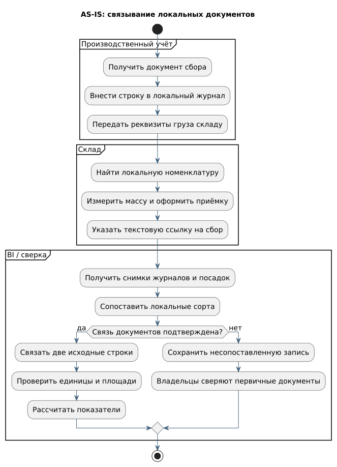
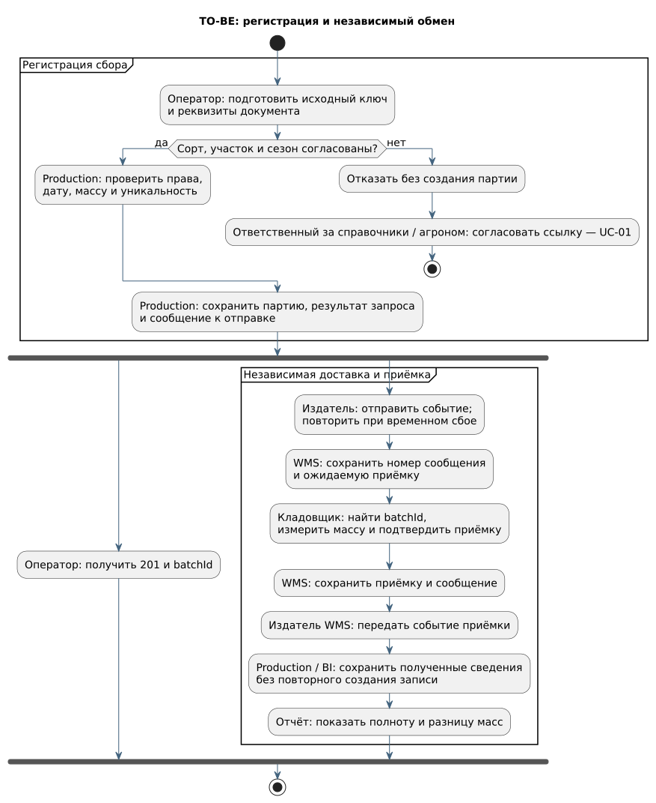

# От исходного документа к показателю отчёта

[← Предметная область](context.md) · [Далее: варианты использования](use-cases.md)

## Исходный порядок работы

Оператор переносит документ сбора в производственный журнал. Кладовщик оформляет складской документ и выбирает номенклатуру из своего справочника. Для «Паспорта сорта» нужны оба набора записей и реестр посадок.

При объединении данных требуется проверить три связи: сорт в разных справочниках, сбор с посадкой в выбранном сезоне, складской документ с производственным. Если связь не установлена, строку нельзя включать в расчёт как подтверждённую пару.

[Исходник UML](../diagrams/as-is-process.puml)

## Что я проработала в процессе

| Этап | Входные сведения | Вопрос анализа | Результат описания |
|:---|:---|:---|:---|
| Подготовка справочников | Коды сортов и реестр посадок | Кто подтверждает соответствие и площадь? | Роли согласования и запрет регистрации с неподтверждёнными ссылками |
| Регистрация сбора | Документ, строка, участок, дата и масса | Чем одна запись отличается от её повторной выгрузки? | Устойчивый ключ и правила повторной обработки |
| Передача складу | Зарегистрированная партия | Что нужно передать, чтобы склад не подбирал сбор по названию? | Общий номер партии и состав реквизитов ожидаемой приёмки |
| Подтверждение приёмки | Складской документ и измерение | Что сохраняется при несовпадении масс? | Два самостоятельных факта и связь между ними |
| Расчёт отчёта | Посадки, сборы, приёмки | Как учитывать несколько сборов и неполные подтверждения? | Раздельные расчёты площади и масс; список неподтверждённых партий |
| Разбор исключений | Исходные строки и причина расхождения | Кто вправе подтвердить исправление? | Передача вопроса владельцу, сохранение основания и повторная проверка |

## Разбор требований на контрольных данных

### Площадь участка повторяется в строках сборов

**Исходные сведения.** Реестр посадок содержит участок, сезон, сорт и площадь. Журнал сбора содержит несколько документов по одному участку. Единица записи у источников различается.

**Вопрос агрономической службе и пользователю отчёта.** Должна ли площадь меняться от количества сборов? Как учитывать плодоносящий участок, по которому сбор ещё не зарегистрирован?

**Правило.** Площадь берётся из посадок за выбранный сезон и учитывается один раз. Отсутствие сбора не исключает подтверждённую площадь из знаменателя.

**Проверка решения.** В контрольном наборе у участка 2 га два сбора, у участка 3 га — один. Если суммировать площадь после соединения со всеми сборами, получится 7 га вместо 5. Поэтому SQL сначала отдельно суммирует площадь и сбор по сорту и сезону. Правильная урожайность — 15 / 5 = 3 т/га. Дополнительная проверка добавляет участок без сбора и проверяет изменение знаменателя.

**Связь документов:** BR-04 → [UC-04](use-cases.md#uc-04) → [SQL расчёта](../sql/02_passport.sql) → AC-11 и [SQL-проверки](../sql/04_checks.sql).

### Отсутствующее подтверждение смешивается с разницей масс

**Исходные сведения.** Производство зарегистрировало 15 т. Складское подтверждение есть только для сбора 8,420 т; склад измерил 8,370 т. Два остальных сбора — 1,580 и 5 т — пока без подтверждения.

**Вопрос производству и складу.** Есть ли документ приёмки для каждой партии? Установлена ли связь документов и совпадают ли единицы измерения?

**Правило.** Для связанной пары сохраняются оба измерения. Разница — −0,050 т. По двум несвязанным партиям отдельно показывается отсутствие подтверждения; их производственная масса — 6,580 т. Вычитание всех складских сведений из всего сбора не является расчётом недостачи.

**Проверка решения.** Отчёт должен показать разницу только подтверждённой пары и полноту 1 из 3 партий. Причину расхождения определяют владельцы документов.

**Связь документов:** BR-03, FR-05 → [UC-03](use-cases.md#uc-03), [UC-04](use-cases.md#uc-04), [UC-05](use-cases.md#uc-05) → AC-09, AC-12.

### Прежний номер документа приходит с другой массой

**Исходные сведения.** Одна строка документа может попасть в несколько выгрузок. Координата строки в файле меняется, хотя исходный факт тот же. Иногда под прежним ключом приходит другое содержимое.

**Вопрос производственному учёту.** Какова область уникальности номера? Сохраняется ли номер строки при повторной выгрузке? Кто вправе подтвердить исправление?

**Правило.** Проверяется сочетание системы-источника и устойчивого ключа документа со строкой. Идентичный повтор не создаёт новую партию. Изменённая масса при том же ключе выделяется как конфликт; зарегистрированный факт автоматически не заменяется.

**Проверка решения.** В [контрольной выгрузке](../examples/legacy-harvest.csv) есть допустимая строка, её повтор и конфликтующая версия. [Проверка выгрузки](../scripts/check_legacy.py) различает эти случаи. Ограничение уникальности в БД дополнительно защищает от повторного создания партии с другим идентификатором.

**Связь документов:** BR-02, FR-07 → [UC-02](use-cases.md#uc-02), [UC-05](use-cases.md#uc-05) → AC-03, AC-20, AC-21.

## Целевой порядок работы

[Исходник UML](../diagrams/to-be-process.puml) · [BPMN производства и склада](../diagrams/batch-process.bpmn)

1. **Ответственный за справочники** подготавливает соответствие кодов; агроном подтверждает сорт и сведения о посадках.
2. **Оператор производства** регистрирует строку сбора. Система проверяет данные и выдаёт номер партии.
3. **Складская система** получает реквизиты партии и создаёт ожидаемую приёмку. Регистрация сбора уже завершена и не ожидает физического поступления груза.
4. **Кладовщик** подтверждает приёмку по номеру партии и сохраняет складскую массу. Склад передаёт сведения производству и отчётности.
5. **Руководитель или агроном** открывает «Паспорт сорта». Видит показатели, полноту приёмки и состав исходных документов.
6. **Аналитик отчётности и владельцы документов** разбирают записи, которые не удалось сопоставить, и расхождения измерений.

## Что остаётся ручным

Система проверяет формат и однозначные связи. Смысл спорного наименования подтверждает агроном, изменённый документ разбирает его владелец, неоднозначную историческую связь устанавливают по первичным документам.

Автоматизация передачи реквизитов не устраняет эти решения. Для них описан [UC-05](use-cases.md#uc-05), а для согласования сорта — [UC-01](use-cases.md#uc-01).

[Далее: спецификации сценариев](use-cases.md).
