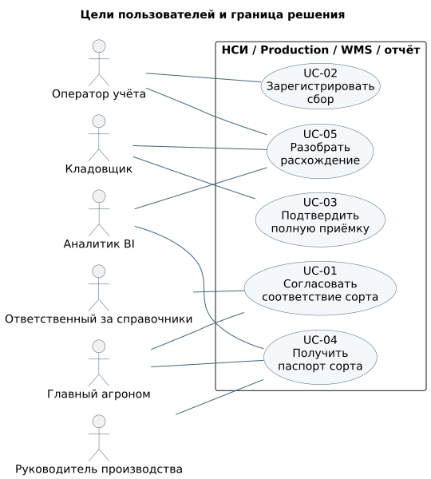

# Варианты использования

[← Порядок чтения](../README.md#artifacts) · [Процесс](processes.md) · [Далее: данные и расчёты](data-model.md)

Сценарии описывают целевой процесс и требования к поведению системы. Реестр соответствий и интерфейсы здесь заданы как часть спецификации.

## Список сценариев

| Сценарий | Задача участника |
|:---|:---|
| [UC-01](#uc-01) | Согласовать соответствие сорта |
| [UC-02](#uc-02) | Зарегистрировать сбор с участка |
| [UC-03](#uc-03) | Подтвердить полную складскую приёмку |
| [UC-04](#uc-04) | Получить «Паспорт сорта» за сезон |
| [UC-05](#uc-05) | Разобрать несопоставленную запись или расхождение |

В каждой спецификации приведены паспорт сценария, нормальный ход и отдельные ветки. AC обозначает альтернативу внутри варианта использования, EX — исключение. Идентификаторы AC-01…AC-21 без префикса UC относятся к [плану приёмки](acceptance.md).

[Исходник UML](../diagrams/use-cases.puml) · [Технические последовательности обмена](integration.md)

## UC-01 · Согласовать соответствие сорта

| Наименование поля | Содержимое |
|:---|:---|
| ID варианта использования | UC-01 |
| Наименование | Согласовать соответствие сорта |
| Кем создан | Елизавета, системный аналитик |
| Период работы над задачей | Весна 2026 года, около квартала |
| Актор | Ответственный за справочники — инициатор; главный агроном — подтверждает сорт; управляемый реестр — хранит решение. |
| Описание | Установить связь локального кода с единым сортом, чтобы записи источника могли участвовать в учёте. |
| Предварительные условия | Доступны система-источник, локальный код и исходное название; у ответственного есть право вести реестр. |
| Постусловие | Для локального кода опубликовано одно подтверждённое соответствие; сохранены основание, автор и согласующий. |
| Приоритет | Высокий — необходим для корректного учёта и расчёта отчёта |
| Частота использования | При появлении нового кода или разборе расхождения справочников. |
| Бизнес-правила | BR-01: один локальный код в источнике соответствует не более чем одному сорту. Похожее название само по себе не подтверждает связь. |
| Специальные требования | FR-06: сохранять основание и согласование; проверять исторические записи перед переназначением. |
| Предпосылки | Согласование выполняется в управляемом реестре; потребители получают утверждённую версию. |
| Содержит / связанные сценарии | Может предшествовать UC-02 и выполняться в ходе UC-05. |

### Нормальный ход событий

| Шаг | Действие актора | Реакция системы |
|:---:|:---|:---|
| 1 | Открывает запись с неизвестным кодом. | Реестр показывает источник, локальный код, исходное имя и существующие соответствия. |
| 2 | Сравнивает запись с кандидатами; передаёт вопрос агроному. | Реестр позволяет указать единый сорт и основание выбора. |
| 3 | После подтверждения агрономом фиксирует решение. | Проверяет, что ключ не связан с другим сортом; сохраняет автора, согласующего и основание. |
| 4 | Включает запись в согласованную версию справочника. | Потребителям становится доступно утверждённое соответствие. |

### UC-01.AC.1 · Нужного сорта нет в едином справочнике

**Точка ветвления:** шаг 2, подходящая запись не найдена.

| Шаг | Действие актора | Реакция системы |
|:---:|:---|:---|
| 1 | Передаёт агроному сведения исходной записи. | Реестр сохраняет обращение без назначения случайного соответствия. |
| 2 | После подтверждения новой записи указывает её единый код. | Реестр принимает код для проверки и согласования. |

**Завершение:** возврат к шагу 3.

### UC-01.EX.1 · Код уже связан с другим сортом

**Точка ветвления:** шаг 3, найдено действующее соответствие.

| Шаг | Действие актора | Реакция системы |
|:---:|:---|:---|
| 1 | Пытается указать другой единый сорт. | Реестр не выпускает изменение до проверки исторических записей. |
| 2 | Передаёт конфликт и связанные документы владельцу данных. | Прежнее соответствие остаётся действующим. |

**Завершение:** сценарий приостановлен до решения владельца.

### UC-01.EX.2 · Не хватает данных для подтверждения

**Точка ветвления:** шаг 2, агроном не подтверждает однозначный выбор.

| Шаг | Действие актора | Реакция системы |
|:---:|:---|:---|
| 1 | Фиксирует необходимость уточнения. | Запись остаётся неразрешённой; соответствие не передаётся потребителям. |

**Завершение:** согласование не завершено; возврат к шагу 2 после уточнения.

**Требования и приёмка:** BR-01, FR-01, FR-06; AC-01, AC-19.

[К списку сценариев](#scenarios)

---

## UC-02 · Зарегистрировать сбор с участка

| Наименование поля | Содержимое |
|:---|:---|
| ID варианта использования | UC-02 |
| Наименование | Зарегистрировать сбор с участка |
| Кем создан | Елизавета, системный аналитик |
| Период работы над задачей | Весна 2026 года, около квартала |
| Актор | Оператор производственного учёта — инициатор; производственная система — проверяет и сохраняет сбор. |
| Описание | По строке исходного документа зарегистрировать партию, связанную с участком, сортом и сезоном, и подготовить данные для склада. |
| Предварительные условия | Документ и строка имеют устойчивый ключ; сорт активен; участок, сезон и соответствие сорта подтверждены; оператор имеет право регистрации. |
| Постусловие | Создана одна партия со статусом REGISTERED; сохранены исходный ключ и масса в кг; подготовлено одно сообщение о регистрации. |
| Приоритет | Высокий — необходим для корректного учёта и расчёта отчёта |
| Частота использования | По мере поступления документов в период сбора урожая. |
| Бизнес-правила | BR-02: одна исходная строка — не более одной партии. Масса положительная; дата не позже текущей и относится к сезону; сорт соответствует посадке. |
| Специальные требования | FR-02: повтор запроса возвращает прежний результат. FR-03: регистрация и подготовка сообщения сохраняются вместе. NFR-02: проверять право регистрации. |
| Предпосылки | Склад подтверждает приёмку отдельно; недоступность WMS не блокирует сохранение сбора. |
| Содержит / связанные сценарии | UC-01 — предварительное согласование неизвестного сорта; UC-03 — последующая приёмка. |

### Нормальный ход событий

| Шаг | Действие актора | Реакция системы |
|:---:|:---|:---|
| 1 | Выбирает исходный документ и строку, участок, сезон и сорт. | Предоставляет согласованные справочные значения. |
| 2 | Вводит дату и массу, отправляет регистрацию. | Проверяет права, формат, допустимые значения и соответствие посадке. |
| 3 | Ожидает результат регистрации. | Проверяет повтор исходной строки, сохраняет партию и данные для отправки складу. |
| 4 | Получает подтверждение. | Возвращает номер партии и статус REGISTERED; API — ответ 201. |

### UC-02.AC.1 · Ответ на регистрацию потерян

**Точка ветвления:** шаг 4, оператор не получил подтверждение.

| Шаг | Действие актора | Реакция системы |
|:---:|:---|:---|
| 1 | Повторяет отправку прежнего запроса. | Клиент использует прежний Idempotency-Key; система возвращает сохранённый ответ и номер партии. |

**Завершение:** успех, новая партия и сообщение не создаются.

### UC-02.EX.1 · Неизвестный или неподходящий сорт

**Точка ветвления:** шаг 2, справочные данные не подтверждены или не соответствуют посадке.

| Шаг | Действие актора | Реакция системы |
|:---:|:---|:---|
| 1 | Отправляет регистрацию с неподтверждёнными данными. | Система отклоняет регистрацию; при неверной связи — 422 INVALID_REFERENCE. |
| 2 | Уточняет реквизиты; для неизвестного кода запускает UC-01. | Партия остаётся несозданной. |

**Завершение:** возврат к шагу 1 после уточнения.

### UC-02.EX.2 · Документ уже зарегистрирован

**Точка ветвления:** шаг 3, исходная строка найдена при новом ключе запроса.

| Шаг | Действие актора | Реакция системы |
|:---:|:---|:---|
| 1 | Отправляет повторную регистрацию документа. | Система возвращает 409 SOURCE_RECORD_EXISTS; второй факт не создаёт. |
| 2 | Проверяет ранее зарегистрированную партию. | Система предоставляет сохранённые реквизиты при просмотре партии. |

**Завершение:** повторная регистрация прекращена.

### UC-02.EX.3 · Изменены данные прежнего запроса

**Точка ветвления:** шаг 3, прежний ключ запроса использован с другой массой или реквизитами.

| Шаг | Действие актора | Реакция системы |
|:---:|:---|:---|
| 1 | Повторно отправляет изменённые данные с прежним ключом. | Система возвращает 409 IDEMPOTENCY_CONFLICT; сохранённые данные не меняются. |

**Завершение:** сценарий остановлен для разбора исходного документа.

### UC-02.EX.4 · Сбой сохранения

**Точка ветвления:** шаг 3, транзакция не завершена.

| Шаг | Действие актора | Реакция системы |
|:---:|:---|:---|
| 1 | Получает ошибку и повторяет запрос после восстановления. | Система не оставляет частично сохранённую партию; повтор обрабатывает с прежним ключом. |

**Завершение:** возврат к шагу 3.

### UC-02.EX.5 · Недопустимые значения или права

**Точка ветвления:** шаг 2, проверка запроса не пройдена.

| Шаг | Действие актора | Реакция системы |
|:---:|:---|:---|
| 1 | Передаёт неверную дату, сезон, массу или запрос без права регистрации. | Система возвращает ошибку значения 422, формата 400, авторизации 401 или прав 403; данных о сборе не создаёт. |
| 2 | Исправляет данные либо получает необходимые права. | Новый допустимый запрос проходит проверки с шага 2. |

**Завершение:** партия создаётся только после успешных проверок.

**Требования и приёмка:** BR-02, FR-01, FR-02, FR-03, NFR-01, NFR-02, NFR-03; AC-02–08, AC-13–14, AC-18.

[К списку сценариев](#scenarios)

---

## UC-03 · Подтвердить полную складскую приёмку

| Наименование поля | Содержимое |
|:---|:---|
| ID варианта использования | UC-03 |
| Наименование | Подтвердить полную складскую приёмку |
| Кем создан | Елизавета, системный аналитик |
| Период работы над задачей | Весна 2026 года, около квартала |
| Актор | Кладовщик — инициатор; WMS — сохраняет приёмку; производственная система и отчётность — получают подтверждение. |
| Описание | Связать принятый груз с зарегистрированным сбором и сохранить складское измерение. |
| Предварительные условия | WMS получила реквизиты партии и создала ожидаемую приёмку; груз поступил; права кладовщика проверены складской системой. |
| Постусловие | Создан один факт приёмки с номером склада и номером производственной партии; складская масса сохранена отдельно; подтверждение подготовлено к отправке. |
| Приоритет | Высокий — необходим для корректного учёта и расчёта отчёта |
| Частота использования | При поступлении партии на склад. |
| Бизнес-правила | BR-03: производственная и складская массы сохраняются отдельно. A-02: в этой версии одна полная приёмка на партию. |
| Специальные требования | FR-04 и NFR-01: повторы не создают вторую приёмку; подтверждение сохраняется для последующей доставки. |
| Предпосылки | Частичные приёмки, объединение и разделение партий относятся к отдельным задачам. |
| Содержит / связанные сценарии | UC-02 — регистрация исходного сбора; UC-05 — разбор расхождений. |

### Нормальный ход событий

| Шаг | Действие актора | Реакция системы |
|:---:|:---|:---|
| 1 | Находит ожидаемую приёмку по номеру производственной партии. | WMS показывает реквизиты сбора. |
| 2 | Указывает массу, измеренную на складе. | WMS проверяет положительное значение и связь с партией. |
| 3 | Подтверждает полную приёмку. | WMS сохраняет складской документ и сообщение о приёмке одной операцией сохранения. |
| 4 | Получает номер складского документа. | WMS передаёт подтверждение производственному учёту и отчётности; получатели связывают документы по batchId. |

### UC-03.AC.1 · Массы различаются

**Точка ветвления:** шаг 2, измерение склада отличается от массы сбора.

| Шаг | Действие актора | Реакция системы |
|:---:|:---|:---|
| 1 | Подтверждает собственное измерение. | WMS сохраняет его отдельно от производственного; расхождение доступно для сверки. |
| 2 | При необходимости передаёт документы на разбор по UC-05. | В отчёте сохраняются оба значения и разница. |

**Завершение:** основной сценарий продолжается с шага 3.

### UC-03.EX.1 · Нет ожидаемой приёмки

**Точка ветвления:** шаг 1, груз прибыл, а реквизиты партии не получены.

| Шаг | Действие актора | Реакция системы |
|:---:|:---|:---|
| 1 | Передаёт номер документа производству и сопровождению. | Проверяется регистрация партии и доставка её реквизитов; случайная связь по названию не создаётся. |
| 2 | После получения реквизитов повторно находит партию. | WMS показывает ожидаемую приёмку. |

**Завершение:** возврат к шагу 1; физическая обработка груза выполняется по складскому регламенту.

### UC-03.EX.2 · Приёмка уже существует

**Точка ветвления:** шаг 3, партия ранее полностью принята.

| Шаг | Действие актора | Реакция системы |
|:---:|:---|:---|
| 1 | Повторно подтверждает ту же партию. | WMS не создаёт вторую полную приёмку; сведения существующего документа сохраняются. |

**Завершение:** повтор прекращён.

### UC-03.EX.3 · Подтверждение не доставлено

**Точка ветвления:** шаг 4, канал обмена недоступен.

| Шаг | Действие актора | Реакция системы |
|:---:|:---|:---|
| 1 | Завершает работу с сохранённым складским документом. | Отправитель сохраняет сообщение до восстановления обмена и повторяет публикацию с прежним eventId. |

**Завершение:** приёмка сохранена; доставка продолжается независимо.

**Требования и приёмка:** BR-03, FR-04, NFR-01; AC-09–10, AC-16–17.

[К списку сценариев](#scenarios)

---

## UC-04 · Получить «Паспорт сорта» за сезон

| Наименование поля | Содержимое |
|:---|:---|
| ID варианта использования | UC-04 |
| Наименование | Получить «Паспорт сорта» за сезон |
| Кем создан | Елизавета, системный аналитик |
| Период работы над задачей | Весна 2026 года, около квартала |
| Актор | Руководитель производства или агроном — инициатор; система отчётности — рассчитывает показатели; аналитик отчётности — проверяет состав данных. |
| Описание | Получить сопоставимые показатели сбора, приёмки и урожайности и раскрыть итог до исходных документов. |
| Предварительные условия | Пользователь имеет доступ к отчёту; доступны согласованные посадки и зарегистрированные факты. |
| Постусловие | Выведены показатели сорта за выбранный сезон, полнота подтверждений и актуальность; итог можно проверить по документам. |
| Приоритет | Высокий — необходим для корректного учёта и расчёта отчёта |
| Частота использования | При контроле сбора и подготовке сезонных итогов. |
| Бизнес-правила | BR-04: площадь участка учитывается один раз за сезон. FR-05: разница масс рассчитывается только по сопоставленным парам. |
| Специальные требования | NFR-04: при штатной обработке подтверждение появляется в отчёте не позднее 5 минут; при задержке показывается признак устаревания. |
| Предпосылки | Используется плодоносящая площадь; качество, хранение и затраты в этот расчёт не включены. |
| Содержит / связанные сценарии | UC-05 — разбор неполных или расходящихся сведений. |

### Нормальный ход событий

| Шаг | Действие актора | Реакция системы |
|:---:|:---|:---|
| 1 | Задаёт сорт и сезон. | Система выбирает посадки и партии по указанным параметрам. |
| 2 | Запрашивает отчёт. | Отдельно суммирует площадь и сбор, сопоставляет имеющиеся приёмки. |
| 3 | Просматривает показатели. | Система показывает сбор, приёмку, долю подтверждённых партий, разницу связанных масс и урожайность. |
| 4 | Открывает состав выбранного показателя. | Система выводит партии и исходные ключи документов, показывает актуальность данных. |

### UC-04.AC.1 · За сезон ещё нет сборов

**Точка ветвления:** шаг 2, есть посадки, но нет зарегистрированных партий.

| Шаг | Действие актора | Реакция системы |
|:---:|:---|:---|
| 1 | Запрашивает отчёт по выбранному сорту. | Система сохраняет подтверждённую площадь, показывает нулевой сбор; доля приёмок не определена. |

**Завершение:** отчёт сформирован.

### UC-04.AC.2 · Не все партии имеют подтверждение

**Точка ветвления:** шаг 3, часть складских сведений отсутствует.

| Шаг | Действие актора | Реакция системы |
|:---:|:---|:---|
| 1 | Открывает список неподтверждённых партий. | Система отделяет их от связанных пар; не относит неподтверждённую массу к потерям. |

**Завершение:** отчёт сформирован с указанием полноты.

### UC-04.EX.1 · Не определена площадь

**Точка ветвления:** шаг 2, нет основания для расчёта урожайности.

| Шаг | Действие актора | Реакция системы |
|:---:|:---|:---|
| 1 | Запрашивает отчёт. | Система не рассчитывает урожайность, показывает отсутствие площади вместо нулевого результата. |
| 2 | Передаёт вопрос агрономической службе. | После уточнения данных возможен повторный расчёт. |

**Завершение:** показатели без зависимости от площади доступны; урожайность ожидает уточнения.

### UC-04.EX.2 · Данные поступают с задержкой

**Точка ветвления:** шаг 4, обработка подтверждений отстаёт более чем на 5 минут.

| Шаг | Действие актора | Реакция системы |
|:---:|:---|:---|
| 1 | Проверяет актуальность отчёта. | Система отмечает устаревшие данные; время последнего сбора не используется как показатель исправности обмена. |

**Завершение:** отчёт доступен с признаком задержки.

**Требования и приёмка:** BR-04, FR-05, NFR-04; AC-11–12, AC-15.

[К списку сценариев](#scenarios)

---

## UC-05 · Разобрать несопоставленную запись или расхождение

| Наименование поля | Содержимое |
|:---|:---|
| ID варианта использования | UC-05 |
| Наименование | Разобрать несопоставленную запись или расхождение |
| Кем создан | Елизавета, системный аналитик |
| Период работы над задачей | Весна 2026 года, около квартала |
| Актор | Аналитик отчётности — инициатор; владельцы исходных документов — подтверждают данные; сопровождение — восстанавливает обмен. |
| Описание | Определить причину отсутствующей связи или разницы значений и подготовить запись к корректной обработке. |
| Предварительные условия | Доступны исходные документы, снимки выгрузок, ключи строк и журнал обработки. |
| Постусловие | Зафиксированы причина и решение либо необходимость дальнейшего уточнения; исходные сведения сохранены; повторная обработка не создаёт дубли. |
| Приоритет | Высокий — необходим для корректного учёта и расчёта отчёта |
| Частота использования | При выявлении исключений загрузки или расхождений в отчёте. |
| Бизнес-правила | BR-03: исходные факты не перезаписываются. FR-07: повтор и изменённая версия документа обрабатываются по-разному. |
| Специальные требования | Сохранять основание решения и устойчивые ключи; не связывать документы по близости даты или массы. |
| Предпосылки | Решения исторической сверки сохраняются в промежуточном слое подготовки данных. |
| Содержит / связанные сценарии | UC-01 — согласование сорта; UC-04 — повторная проверка отчёта. |

### Нормальный ход событий

| Шаг | Действие актора | Реакция системы |
|:---:|:---|:---|
| 1 | Открывает запись сверки и определяет вид проблемы. | Показываются источник, ключ строки, значения и причина исключения. |
| 2 | Проверяет документы, единицы измерения и связи; направляет вопрос владельцу. | Сохраняются сведения, необходимые для разбора; при сбое обмена используется номер сообщения. |
| 3 | Получает решение владельца документа и фиксирует основание. | Сохраняется решение о подготовке записи к повторной обработке. |
| 4 | Запускает повторную проверку или передаёт сообщение сопровождению. | Обработка использует прежние устойчивые ключи; сверяются количество записей и суммарная масса. |

### UC-05.AC.1 · Приёмка существует, сообщение не дошло

**Точка ветвления:** шаг 2, склад подтверждает наличие документа.

| Шаг | Действие актора | Реакция системы |
|:---:|:---|:---|
| 1 | Передаёт идентификатор сообщения сопровождению. | Восстанавливается доставка существующего подтверждения, новый складской факт не создаётся. |
| 2 | Проверяет связь в отчёте. | Подтверждение связано с исходной партией. |

**Завершение:** возврат к шагу 4.

### UC-05.AC.2 · Нужно согласовать сорт

**Точка ветвления:** шаг 2, нет утверждённого соответствия кода.

| Шаг | Действие актора | Реакция системы |
|:---:|:---|:---|
| 1 | Передаёт код ответственному за справочники по UC-01. | Запись остаётся неразрешённой до получения подтверждённого соответствия. |

**Завершение:** возврат к шагу 3 после UC-01.

### UC-05.EX.1 · Изменён уже зарегистрированный документ

**Точка ветвления:** шаг 3, две версии содержат разные значения.

| Шаг | Действие актора | Реакция системы |
|:---:|:---|:---|
| 1 | Передаёт обе версии владельцу документа. | Система сохраняет конфликт; зарегистрированный факт не перезаписывается автоматически. |

**Завершение:** корректировка передана в отдельный процесс.

### UC-05.EX.2 · Связь документов не подтверждена

**Точка ветвления:** шаг 3, данных для однозначного решения недостаточно.

| Шаг | Действие актора | Реакция системы |
|:---:|:---|:---|
| 1 | Фиксирует необходимость уточнения. | Запись остаётся несопоставленной; расхождение не объявляется потерей. |

**Завершение:** сверка не закрыта до получения основания.

**Требования и приёмка:** FR-05, FR-07, BR-03; AC-12, AC-20–21.

[К списку сценариев](#scenarios)
